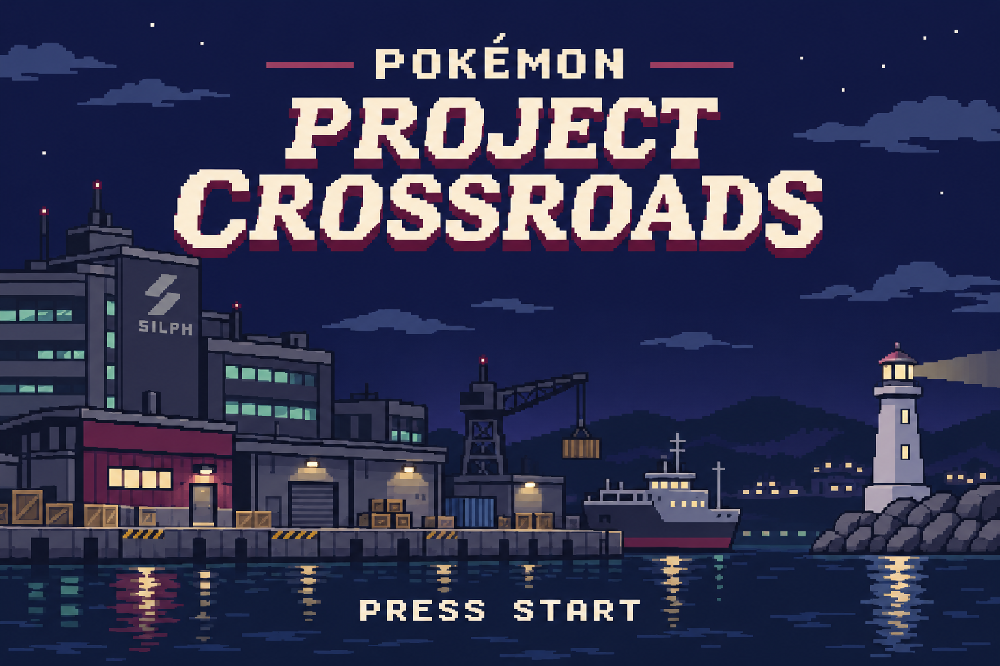

# Title-screen visual proposal — awaiting owner review

Original generated concept for Pokémon: Project Crossroads: navy/charcoal Olivine
harbor, Silph office/freight quay, muted teal lights, burgundy accents and lighthouse.
This illustration was generated for the project; it is not copied game art.
The owner has been shown the image and asked whether to use this direction.
No approval has been received yet. It is not integrated in a ROM and not final canon.

Source PNG: 1536×1024. Native target: 240×160, 3:2, palette/tile limits and legibility
verified in an emulator. The concept image is not claimed to meet those constraints.
Do not silently treat it as an engine-ready sprite sheet or palette asset.

After art-direction review, implement a separate title-screen prototype using the
existing graphics/sound systems. Test Start, main menu, New Game, Continue and reset.
Keep the accepted exploration/met-location increment independently buildable. Audio
may use an explicitly identified temporary existing engine track until original or
appropriately licensed new music is ready. This proposal does not change gameplay,
menus, save data, protagonist graphics or the original introduction.

Architecture inspected: src/intro.c handles boot/copyright and old introductory
animation; src/title_screen.c initializes the Emerald logo, version sprites,
Rayquaza/cloud backgrounds and Start transition; src/main_menu.c owns Continue and
Birch/new-game presentation; src/new_game.c still selects the truck start. Preserve
these underlying contracts when replacing the presentation. Do not remove legacy
assets needed by legitimate later Hoenn content.
