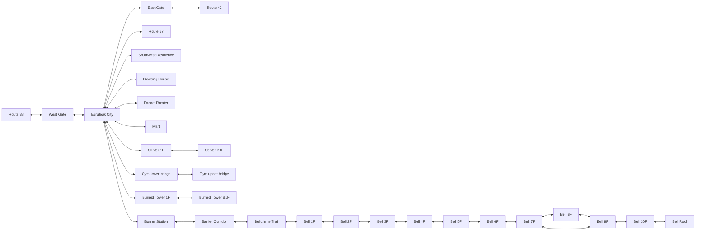

# Ecruteak QA07 traversal overview

All nodes below are existing maps. IDs, connection offsets and entrance indexes
are unchanged. Actual doorway/pad pairs and map-header connections are recorded
individually in [the checklist](ecruteak-qa07-checklist.json) and
[controller coverage](../qa/ecruteak-qa07/city-tour/coverage.json).

The Bell outline shows floor order; individual same-map pads, cross-floor branches,
one-way ledges and disjoint walkway components require the exact warp graph in
the JSON/coverage. The emulator plans by entry position, not just floor name.
Gym falls return to the lower entrance without granting badges or story flags.

The city retains its west/east map-header scrolling connections for rendering;
walking the three-cell apertures executes the existing coordinate gate scripts.
South remains a normal route border. Blocked north/perimeter and pond edges were
checked; decorative closed homes have explicit private-door text, no empty rooms.
