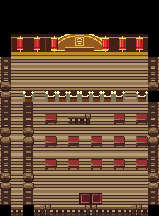

# Ecruteak Theater reference follow-up — QA09

The **complete13-seat audience arrangement now has an actual published HGSS raster reference**. The [WikiDex image](https://images.wikidexcdn.net/mwuploads/wikidex/0/09/latest/20100424181308/Teatro_de_Danza_HGSS.jpg), published on [Teatro de Danza](https://www.wikidex.net/wiki/Teatro_de_Danza), is a verified256×192 JPEG. SHA256: `05a655b8cc52f311c8660a1fb4dfeee3eeae5cf7e253a4651ae02e53b013421e`.

It shows the gold/red stage, both side stairways and all13 purple audience cushions: three in front, five in the middle and five behind. These agree with the actual source model56 anchors. The front row deliberately has no seats at6,10 or8,10. The native full layout preserves those aisles.

| Inspected actual HGSS reference | Current full native layout |
| --- | --- |
|  |  |

The historical5664 layout used red wooden benches and wooden audience flooring. Revision `7d92f79357b744dddb706bba121d7bd5e6fc4254` (BUILD10), retained in final BUILD11 source `489c404346f572aefb6856b3dd48a9b364a08ceb`, corrects those source-visible mismatches with13 original purple cushions and light-green checker audience flooring, retaining the brown stage. All source anchors, public floor, collision, actors and IDs remain. The stage/rope/lantern architecture is a flat original GBA adaptation, not a claim of literal DS pixel identity. The linked full-layout research image is historical and must not be mistaken for the new delivery ROM; final native evidence is recorded under the Ecruteak final review.

**The southern threshold/margins are still absent from the recovered raster.** The source exit7,17 and native visible second leaf8,17 have source-event/permission and actual gameplay evidence; the image cannot establish their precise DS appearance. No published whole-floor mosaic or complementary south-room photograph was found after searching Serebii, Archives, WikiDex, Pokébip, Poképédia, StrategyWiki and additional guides. Gold/Silver maps and fan redrawn maps were excluded.

The [detailed reference record](ecruteak-theater-reference-followup.json) preserves URL, checksum, dimensions, source anchors, comparisons and the exact remaining limitation. No game files or textures were changed/imported during this research. Owner visual acceptance remains separate.
