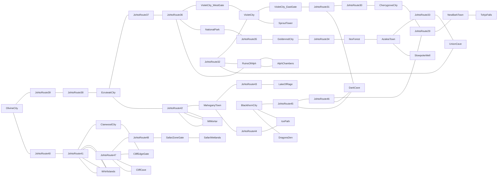

# Johto exploration topology

Existing western maps are retained. Append-only IDs and coverage: [manifest.json](manifest.json).

League approach terminates at a labeled Kanto boundary beyond Tohjo Falls; no other region or League completion is claimed.

Each cluster must compile and pass topology checks before the next. Services/rooms have reciprocal exits. New rosters and teams remain pending. Test water access will be session-only and explicitly labeled.

## Current validation

149 maps built;112 new maps controller-visited. Final tour checked141 unique
roundtrip door/border pairs and622 transitions. See coverage.json and DELTA_QA.md.
Group75 uses nums0..126; group 76 uses0..21, avoiding reserved dynamic mapNum 127.
Field atlas is informational; routes/caves/water provide actual travel.
Kanto/League beyond Tohjo is a documented safe boundary, not a completed region.

QA06 retains the same city/route traversal through actual Violet gatehouse rooms.
The direct draft west/east border connections are replaced by reciprocal doorway
portals; Route32 remains a normal scrolling connection with offset9/-9. All old
map/layout/heal IDs are retained; Violet basement and two gates append.
